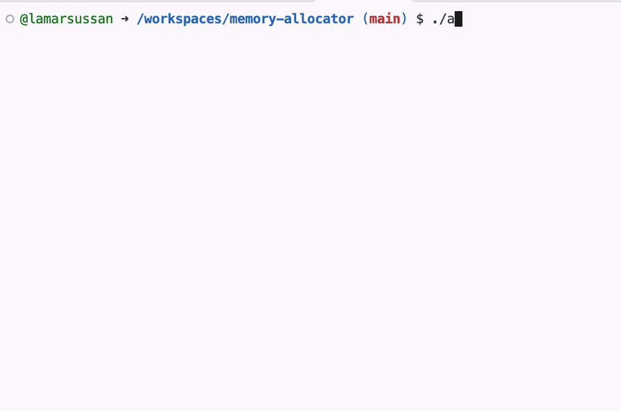

<div align="center">

# 🧠 Memory Allocator

### Custom Dynamic Memory Management in C++


</div>

---

## 🚀 Overview

A custom **dynamic memory allocator implemented in C++ on Linux**, designed to explore low-level memory management without relying on standard memory allocation functions.

The implementation demonstrates how memory is requested from the operating system, tracked using metadata, and reused through allocation and deallocation mechanisms.

---

## 🎬 Live Demo

A short demonstration of dynamic memory allocation, deallocation, and memory reuse using my custom C++ allocator.

<p align="center">
  
</p>


## ✨ Key Features

### 🧩 Dynamic Memory Allocation
- Implemented custom memory allocation functions.
- Used `sbrk` for heap memory allocation.
- Managed allocation requests without standard allocation functions.

### ♻️ Memory Block Management
- Tracked allocated and free memory blocks using metadata.
- Implemented reuse of previously freed blocks.
- Managed memory blocks using linked structures.

### 🔄 Buddy Allocation
- Implemented buddy-based memory allocation.
- Supported memory block splitting and merging.
- Managed memory reuse through block organization.

### 💾 Low-Level Memory Operations
- Used `mmap` and `munmap` for large allocations.
- Worked with low-level Linux memory management mechanisms.

---

## 🛠️ Technologies

| Technology | Purpose |
|------------|---------|
| C++ | Core implementation |
| Linux | Execution environment |
| sbrk | Heap memory allocation |
| mmap / munmap | Memory mapping |
| Buddy Allocation | Block splitting and merging |

---

## 📂 Project Structure

```text
memory-allocator/
├── malloc_1.cpp
├── malloc_2.cpp
├── malloc_3.cpp
└── README.md
```

### Implementation Files

- `malloc_1.cpp` — Basic dynamic memory allocation.
- `malloc_2.cpp` — Metadata-based allocation, block reuse, and memory tracking.
- `malloc_3.cpp` — Extended allocator with buddy allocation and advanced memory management.

---

## 🧠 Technical Concepts

This project explores several important systems programming concepts:

- Dynamic memory allocation
- Heap management
- Memory block metadata
- Memory reuse and fragmentation
- Buddy allocation
- Pointer arithmetic
- Linux memory management

---

## ⚙️ Development Environment

**Language:** C++

**Platform:** Linux

**Compiler:** g++

The repository contains allocator implementations intended to be compiled and used with a compatible test program.

---

<div align="center">

### 💻 Built with C++ and Linux

*Exploring how memory allocation works under the hood.*

</div>
